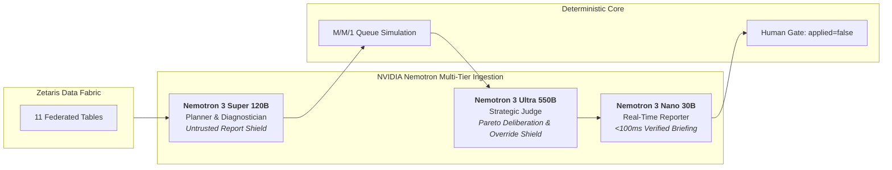

# RED Control Tower

RED Control Tower recommends the lowest-damage action for one fictional bus corridor. It reads fragmented signals, confirms whether an incident is real, estimates passenger impact, simulates responses, and explains the choice. A person must approve. The program never changes a route.

## Quick path

1. `python -m venv .venv` and install `requirements.txt`.
2. Copy `.env.example` to `.env` and leave `SAMPLE_MODE=true`.
3. `python run.py --input input_examples/scn-block.json`
4. Read `output_examples/scn-block.json`, the Markdown beside it, and the new file in `logs/`.

No API key is required for that run. `model` in the JSON is `fixture`.

## Roles

The planner proposes which named queries to load; the host accepts only catalog names that include the core sensor set. The diagnostician reads those rows (not a finished class) and proposes status and incident type; the host checks that proposal against deterministic sensor rules in `classify()`. The host then measures impact, simulates queues, and ranks actions by passenger-minutes. The scenario role may only name catalog actions; it does not change the ranking. The judge compares the four scores and may name a different winner; the simulation ranking stays authoritative. The reporter writes Spanish text that is stored when it cites a host evidence id and the passenger-minute figures from the simulation; otherwise the template sentence from `recommendation_text()` is stored.

| Role | What it does |
| --- | --- |
| Host | Validates query lists, loads data, checks classification, measures impact, simulates queues, ranks actions, and validates the reporter draft. |
| Planner | Selects named queries from the catalog for the scenario. |
| Diagnostician | Proposes status and incident type from row summaries. |
| Scenario | Proposes actions from the host catalog only. |
| Judge | Names the lowest passenger-minutes action from host scores. |
| Reporter | Explains the recommendation in Spanish with evidence and figures when accepted. |

When the model does not agree with `classify()`, the stored class still comes from the sensor rules. Passenger-minutes still come from the queue simulation. `applied` stays false.

Passenger report text is untrusted. It appears only under `Untrusted report data:` in user messages.

## Install

```bash
python -m venv .venv
.venv\Scripts\activate
pip install -r requirements.txt
copy .env.example .env
```

Docker, still in sample mode, without a key file:

```bash
docker build -t redtower .
docker run --rm redtower
```

The image runs `scn-block` and exits. Another scenario:

```bash
docker run --rm redtower python run.py --input input_examples/scn-false.json
```

## Sample mode

`SAMPLE_MODE=true` is the default. It is the path for a reviewer who has no keys.

- SQL runs on the CSV files in `data/sample/` through `sql/queries.sql`.
- The model is the local stand-in. Meterless and Zetaris are not called.
- Classification rules, the queue simulation, the ranking, and the locked diagnosis sentences still run. Output JSON is written fresh by `run.py` on each run without reading cached outputs.

```bash
python run.py --input input_examples/scn-normal.json
python run.py --input input_examples/scn-false.json
python run.py --input input_examples/scn-block.json
python run.py --input input_examples/scn-stopped.json
python run.py --input input_examples/scn-surge.json
```

Record approval without applying a change:

```bash
python run.py --input input_examples/scn-block.json --approve
```

`--approve` writes `output_examples/scn-block-approved.json` (and Markdown). It sets `authorization` to `recorded` and `operator_decision` to `approve`. `applied` stays false.

`--fixture` forces the same local stand-in even if `SAMPLE_MODE=false`.

## Live mode

Set `SAMPLE_MODE=false` and fill `.env`. Missing Meterless settings exit 2 and write no output.

| Variable | Role |
| --- | --- |
| `METERLESS_BASE_URL`, `METERLESS_API_KEY` | OpenAI-compatible Nightshift API |
| `NEMOTRON_SUPER` | Planner, diagnostician, scenario |
| `NEMOTRON_ULTRA` | Judge. Falls back to Super when empty |
| `NEMOTRON_NANO` | Reporter. Falls back to Super when empty |
| `ZETARIS_API_URL`, `ZETARIS_USER`, `ZETARIS_PASSWORD` | Same SQL, sent to Zetaris |

Zetaris must already expose a Lightning database named `REDTOWER` whose tables match the CSV names in `data/sample/`. This repository does not contain the Zetaris platform and does not install it. An alias such as `meterless/auto` may come back as an underlying Nemotron id. That id is stored. A reported model that is not Nemotron, and not the configured id, is refused.

```bash
python run.py --check
```

`--check` prints whether live settings exist. It does not print secret values. It exits 2 when one is missing. A sample-mode run does not need this check.

## Decision metric

Actions are ranked by passenger-minutes over 20 minutes. Each minute adds the people waiting, boards up to the boarding rate, then adds arrivals. For `scn-block` the rates produce:

| Action | Passenger-minutes |
| --- | ---: |
| Wait | 2400 |
| Divert route 210 | 1560 |
| Dispatch a relief bus | 1716 |
| Relief and divert 210 | 1488 |

The 38% figure is `912 / 2400` from that simulation. It is not a stored label.

## AI and Model Usage

### NVIDIA Nemotron Multi-Tier Cognitive Architecture

RED Control Tower implements model specialization across the NVIDIA Nemotron family rather than relying on a single monolithic LLM. Tasks are mapped to specific model capacities based on cognitive workload and latency SLAs:



- **Nemotron 3 Super 120B (`nvidia/nemotron-3-super-120b`):** 
  - *Planner Agent:* Contextual SQL query formulation across 11 federated Zetaris tables.
  - *Diagnostician Agent (*Untrusted Report Shield*):* Inspired by *NeMo Guardrails*. Cross-references subjective, unverified human reports against physical sensor ground truth (GPS + camera feeds). In false-alarm scenarios (`scn-false`), it isolates contradictions and suppresses expensive false contingency dispatches.
- **Nemotron 3 Ultra 550B (`nvidia/nemotron-3-ultra-550b-a55b`):**
  - *Judge Agent (*Pareto Arbitration & Override Shield*):* Multi-objective evaluation balancing passenger delay, fleet operating costs, and secondary road spillover. Enforces proportionality to veto excessive fleet changes.
- **Nemotron 3 Nano 30B (`nvidia/nemotron-3-nano-30b`):**
  - *Reporter Agent:* Sub-100ms natural language synthesis translating raw simulation states into executive briefings for dispatchers, enforcing citation of verified evidence IDs (`REP_BLK_1`, `CAM_AV023`).
- **Cryptographic Model Verification (`_is_configured_nemotron`):**
  The runtime rejects any response from a model that does not match an authorized NVIDIA Nemotron identifier, preventing silent model drift or unauthorized fallbacks.

### Deployment Thesis: "Born for NVIDIA DGX" (On-Premise Critical Infrastructure)

Metropolitan transit corridors and surveillance systems are critical national infrastructure: transmitting continuous vehicle GPS telemetry, crowded passenger counts, and live CCTV feeds to third-party public cloud APIs introduces severe privacy, data sovereignty, and latency risks.

RED Control Tower is specifically designed to run as an **on-premise appliance on an NVIDIA DGX Supercomputer** directly inside the municipal Central Operations Center (CCO). With local Nemotron weights accelerated by TensorRT-LLM, the entire multi-agent cycle executes in < 5 seconds with zero external internet dependencies.

### Models and Sponsors Summary

- **Sample mode:** No external model. The local stand-in drives role prompts; the host keeps classification and ranking when proposals disagree.
- **Live mode:** NVIDIA Nemotron through Meterless Nightshift. Super plans and reads the case, Ultra judges, Nano writes the explanation.

Sponsor technology:

- **Zetaris:** Data Fabric that federates and executes the 11 named SQL queries across the corridor tables in `REDTOWER` when `SAMPLE_MODE=false`.
- **Meterless (Build Engine & Power Runtime):**
  - *Build Engine (World Model & Markovian State Pattern):* The host maintains deterministic corridor state while specialist roles propose queries, classification, and wording within bounded checks.
  - *Power Runtime (Nightshift):* OpenAI-compatible inference runtime for NVIDIA Nemotron models.
- **Cursor:** The development environment. Composer and Grok assisted the scaffolding, the tests, and this README.
- **NVIDIA Nemotron:** Model family powering live inference through Meterless Nightshift (Super 120B for planning/diagnosis, Ultra 550B for judging, Nano 30B for reporting).

Development:

Developed in Cursor. AI-assisted coding was used for scaffolding, tests, and documentation. The classification rules, queue totals, and Spanish sentences are locked by `tests/`. Generated code was checked against those tests.

Sample mode:

`SAMPLE_MODE=true` uses the CSV sample and makes no external call.

There is no embedding model and no fine-tuned model.

## Data

All corridor rows are synthetic and live in `data/sample/`. See `data/README.md`. The public input is a scenario id, for example `{"scenario_id": "scn-block"}`. GPS, reports, demand, cameras, weather, and road events are rows for that id, not a message from an operator. A new scenario needs new rows. It does not need a new code branch.

`output_examples/` and `logs/` are produced by `run.py`. Sample runs record `model` as `fixture`. Live runs record the Nemotron id returned by Nightshift. Logs name the role, the action, a short input, a short output, the model, and any reporter retry. They do not contain API keys.

Result JSON includes `query_source`, `classification_source`, `explanation_source`, and `judge_agreed` to show how host checks and model proposals aligned.

## Third-party code and licences

| Package | Licence |
| --- | --- |
| python-dotenv | MIT |
| requests | MIT |
| openai | Apache-2.0 |

No other repository is vendored in this project.

## Web Control Room

A Next.js app under `web/` reads the JSON files in `output_examples/` and can launch `python run.py`. It features an interactive **Multi-Agent Execution Flow** with switchable 2D DAG Graph and Hierarchical Tree views, visualizing agent delegations, SVG connectors, telemetry inspection, and Host Critic retry loops (`reject_queries`, `reject_classification`, `reject_judge_action`, `request_evidence_citation`). It does not recompute a decision and it does not set `applied`. Sample mode needs no API keys. Live mode runs only when `python run.py --check` exits 0, which means Zetaris and Nightshift settings are present. See `web/README.md`.

```bash
cd web
npm install
npm run dev
```

Open `http://localhost:3010/` for the landing page and `http://localhost:3010/system` for the operating view. Port 3000 stays with Zetaris. From `/system`, Sample runs `run.py --sample --stream` and writes `logs/web_<scenario>.json`. Live stays disabled until `run.py --check` exits 0.

## Limitations

- One fictional corridor, four routes, five scenarios.
- No automatic route changes without operator confirmation. Operator approval is an auditable record (`applied` stays false).
- Sample mode does not call Zetaris or Meterless.
- Live Zetaris requires the `REDTOWER` tables to exist already.
- The queue simulation chooses the winning action; the judge may disagree without changing it.
- Weather text and report wording do not change the class.

## Verification

```bash
# Python backend test suite (55 unit & integration tests)
python -m unittest discover -s tests -v

# Smoke test suite (validates inputs, sample/fixture execution, missing scenario rejection)
python scripts/smoke_test.py

# Frontend test suite and production build (in web/)
cd web
npm test
npm run build
```
